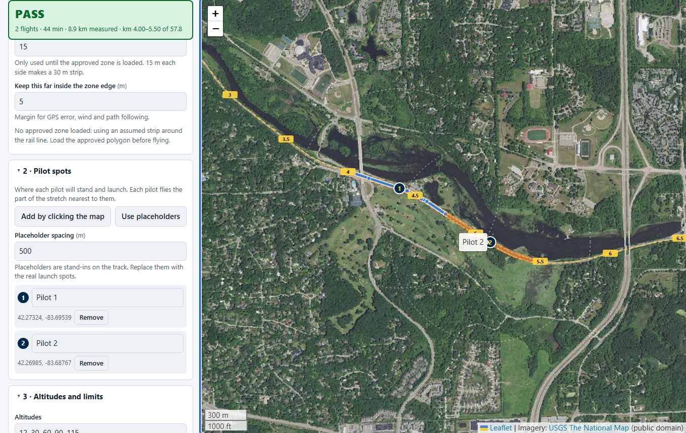
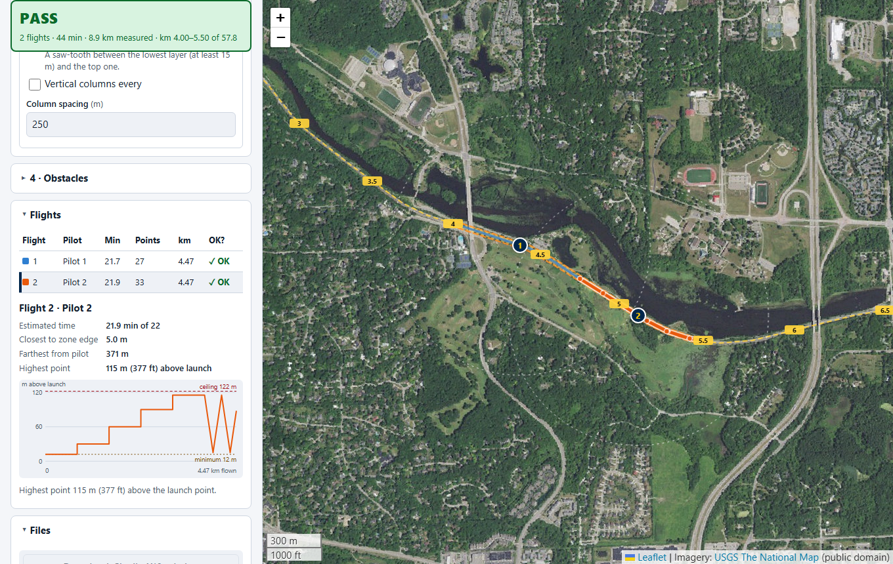
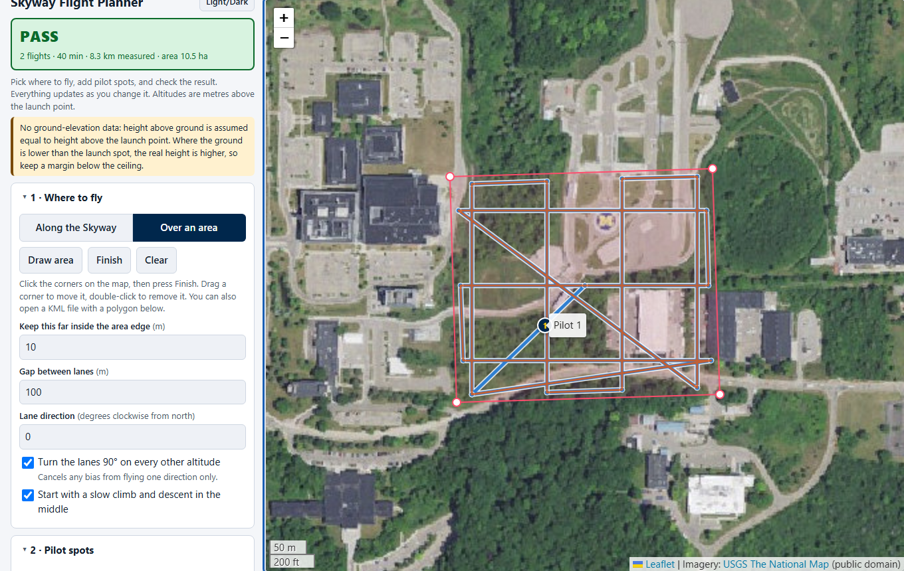
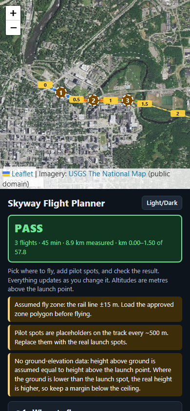
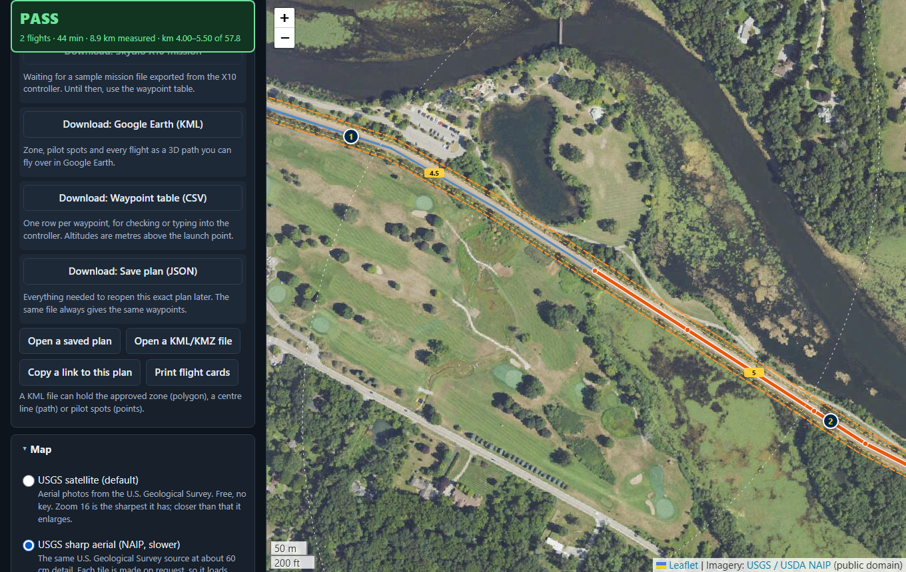

# Skyway Flight Planner

A point-and-click planner for **measurement flights** that collect 4G/LTE signal data (Rohde & Schwarz QualiPoc on a Skydio X10) along the M-air Skyway rail corridor or over an area. It works out waypoints, splits them into battery-sized flights, checks every metre of the path, and gives you files for the drone.



> **Planning aid only.** It does not know the airspace. Check Aloft / B4UFLY (and LAANC near Willow Run and Detroit Metro) and follow flight-operations rules before flying. Until the approved fly-zone polygon is loaded, the zone is **assumed** and the app says so.

## For pilots: how to use it

Open the link (or the downloaded `skyway-planner.html`, which also works with no internet except for the map pictures). Everything updates as you change it.

1. **Where to fly.**
   - *Along the Skyway:* press **Pick on map** and click the dashed yellow rail line where the stretch should start, or type the kilometre. Set the length. The numbers on the line are kilometres from Ann Arbor.
   - *Over an area:* press **Draw area**, click the corners, press **Finish**. Drag a corner to move it, double-click to remove it.
2. **Pilot spots.** Press **Add by clicking the map** and click where each pilot will stand. Drag the numbered circles to move them. Each pilot flies the part of the stretch nearest to them. Until you add real spots, brown dashed **placeholder** circles stand in; replace them.
3. **Altitudes and limits.** Altitudes are **metres above the launch point**, the same as the Skydio waypoint altitude. The defaults are 12, 30, 60, 90 and 115 m, 5 m/s, 22 minutes of battery, a 400 ft ceiling and 700 m farthest from the pilot.
4. **Read the banner.** **PASS** means every flight stays inside the zone (with the edge margin), under the ceiling, within reach of its pilot, clear of obstacles, and inside the battery time. **FAIL** says what went wrong in plain words. A red ring on the map marks the first problem point. Yellow messages are warnings, not failures.
5. **Look at each flight.** Click a row in **Flights** (or a line on the map). You get its time, how close it gets to the zone edge, how far it goes from the pilot, and an altitude chart with the ceiling drawn in.
6. **Take the files.** Under **Files**: Google Earth KML, the waypoint table (CSV), and a saved plan you can reopen later. **Print flight cards** gives one page per flight with the pilot spot, a checklist and the waypoint table.



Area mode, with lanes turned 90° on alternate altitudes:



### Good to know

- **Straight lines back to the pilot.** If the straight line between a pilot and the route would cross outside the zone, you get a warning. Set Skydio's **Backtrack** return mode.
- **Obstacles.** Add towers and tall trees by clicking the map. The drone must stay below the obstacle's height plus 15 m, or outside its keep-out distance.
- **Height above ground.** Tick *Check the true height above ground* to look up ground height from the U.S. Geological Survey. Ground lower than the launch spot raises the real height. The waypoints do not change.
- **Opening a saved plan always gives the same waypoints.** Use this to fly the same route again for another signal band.
- **Phone and tablet.** On a narrow screen the map sits on top and the controls scroll underneath.
- **Share.** *Copy a link to this plan* gives a link that opens exactly this plan.



### Map pictures (all free)

| Choice | What it is |
|---|---|
| **USGS satellite** (default) | U.S. Geological Survey aerial photos, public domain, no key. |
| **USGS sharp aerial (NAIP)** | The same agency at about 60 cm detail, made tile by tile, so it is slower. Best zoomed in. |
| Sentinel-2 cloudless | Open European satellite mosaic, coarse, good for the whole Skyway. Non-commercial terms. |
| Esri World Imagery | Sharper in towns. |
| Street map | OpenStreetMap. |
| Google satellite | Optional. Paste your own Maps Platform key (Map Tiles API enabled). It stays in your browser only. |



## What is not final yet

These are the open items; the app works with clearly marked stand-ins until they arrive. Details and owners are in [docs/assumptions.md](docs/assumptions.md).

- Approved fly-zone polygons (Skyway, and any area): **assumed 30 m strip** until loaded (open a KML with the polygon).
- **Skydio X10 waypoint file:** the button is there but disabled until a sample mission exported from the controller is added to `reference/`. See `src/exporters/skydio.ts`.
- Real pilot / launch spots and obstacle coordinates.
- The time model constants are estimates: calibrate after the first real flight (Advanced settings).

---

## For developers

TypeScript + Vite, static build, no backend. Leaflet for the map, proj4 for a local metric frame, fflate for KMZ and share links. Nothing else at run time.

```
npm install
npm run dev            # http://localhost:5173
npm test               # unit, golden and property tests (Vitest)
npm run lint && npm run typecheck
npm run build          # dist/, for GitHub Pages
npm run build:single   # dist-single/index.html: one file, works offline except imagery
npx playwright install chromium
npx playwright test    # end-to-end (builds and serves the app)
SHOTS=1 npx playwright test screenshots   # refresh docs/screenshots (needs internet)
LIVE=1 npx playwright test dem-live       # talk to the real USGS elevation service
```

### Layout

```
src/core/        the planner: no DOM, no randomness, no map library
  plan.ts          plan(config) -> { flights, notes, verdict, ... } (and planStrict, which throws PlanError)
  patterns.ts      linear passes, porpoise, columns, lawnmower, vertical profile
  split.ts         time model, densify to <= 100 m, greedy fill + balancing
  geo.ts           local frame (proj4), polylines, Douglas-Peucker, polygon helpers, snapping
  defaults.ts      every default value
src/io/          KML/KMZ import (and what it does to a plan), 3DEP ground elevation
src/exporters/   KML, CSV, plan JSON, Skydio (stub); add a format by implementing `Exporter`
src/ui/          map, panel, flight chart, print cards, share links (plain TypeScript)
tests/           core, golden (vs the Python reference), exporters, KML, DEM, e2e
docs/            assumptions.md (every default and who confirms it), golden.md
reference/       the prototype, the Python planner, the original Skyway KML (kept local, not committed)
```

### Rules the core keeps

- **Deterministic.** The same config gives byte-identical output. A saved plan is the full config, so loading it reproduces the waypoints exactly. There is a test for this, including a JSON round trip.
- **Metres only in a local frame.** Distances are never computed in degrees. Km along the Skyway uses per-edge WGS84 scale factors.
- **Checks sample the real straight-line path** between waypoints every 1 m (never more than 2 m), against the zone minus the edge margin, the ceiling and floor, the distance from the pilot, and obstacle cylinders.
- **Curves.** Legs follow the centreline within 2 m (Douglas–Peucker). Patterns start where the previous one ended, so the drone never cuts straight across a bend between them.

### Tests

- **Golden cases** from the Python planner (`tests/golden/`): flight counts must match, durations within a few percent. See [docs/golden.md](docs/golden.md) for how the reference numbers were made and every deliberate difference.
- **Property test:** 40 random stretches of the real Skyway keep every path point within 2 m of the centreline (and so inside half-width minus margin).
- **End to end:** load, pick a stretch, add two pilot spots, PASS and the flight count, download the KML and parse it; save and reopen a plan; draw an area; phone width; the single file offline.

### Adding the Skydio export

1. Put the exported X10 mission in `reference/`.
2. Write down its structure in `docs/skydio-format.md`.
3. Implement `export` in `src/exporters/skydio.ts` to match it exactly, set `available: true`.
4. Un-skip the round-trip test in `tests/exporters.test.ts`.

### Deploying

Push to `main`: `.github/workflows/deploy.yml` lints, tests, builds and publishes to GitHub Pages (set Pages to "GitHub Actions" in the repository settings). The same page also serves `skyway-planner.html`. Push a tag like `v0.1.0` and `release.yml` attaches the single file to a release. `ci.yml` runs everything, including the end-to-end tests, on every push and pull request.

## Licence

MIT. See [LICENSE](LICENSE). Imagery is under its providers' terms; see [docs/assumptions.md](docs/assumptions.md).
